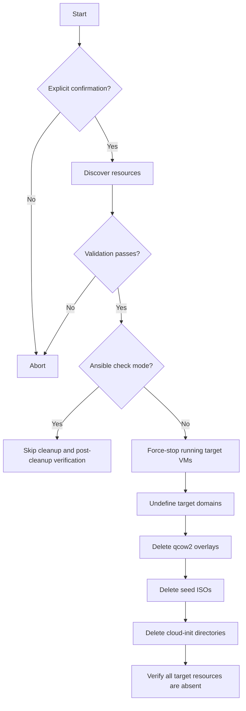

# Automated VM Destruction with Ansible and libvirt

## 1. Purpose

`kubelab` is a reproducible infrastructure homelab using Ubuntu Server, KVM/QEMU, libvirt, Ansible, and Kubernetes. Its virtual machines are disposable: we need to be able to tear down an experimental cluster and recreate it from a known baseline.

The initial cluster used three `k3s-*` VMs. Moving toward upstream Kubernetes with `kubeadm` gave us a concrete reason to start clean rather than carry forward guest configuration, cloud-init state, and experimental changes.

The `kubelab-vms-destroy` Ansible role provides the teardown half of the VM lifecycle; `kubelab-vms` provides provisioning.

## 2. Why not delete VMs manually?

A libvirt guest is more than its running process. In this lab, each guest has:

- A libvirt domain definition, possibly running.
- A VM-specific qcow2 overlay disk.
- A VM-specific cloud-init NoCloud seed ISO.
- A directory holding generated cloud-init data.

Stopping a VM does **not** undefine it. Undefining it does **not** necessarily remove its disk or cloud-init files. Manual teardown across several guests is repetitive and can leave orphaned resources.

Our goal is a repeatable, **idempotent** reset: run the same playbook again after a successful teardown and it should not fail merely because the VMs are already gone.

## 3. Infrastructure and deletion boundaries

Original target guests:

| VM              | Address      | Purpose       |
| --------------- | ------------ | ------------- |
| `k3s-control-1` | `10.20.0.10` | Control plane |
| `k3s-worker-1`  | `10.20.0.11` | Worker        |
| `k3s-worker-2`  | `10.20.0.12` | Worker        |

They used the `k3s-lab` libvirt NAT network (`10.20.0.0/24`) and VM storage under `/var/lib/libvirt/images/`.

Representative storage layout **before** destruction:

```text
/var/lib/libvirt/images/
├── ubuntu-24.04-base.img         # shared backing image: preserve
├── k3s-control-1.qcow2           # remove
├── k3s-control-1-seed.iso        # remove
├── k3s-control-1-cloud-init/     # remove
├── k3s-worker-1.qcow2            # remove
├── k3s-worker-1-seed.iso         # remove
├── k3s-worker-1-cloud-init/      # remove
├── k3s-worker-2.qcow2            # remove
├── k3s-worker-2-seed.iso         # remove
└── k3s-worker-2-cloud-init/      # remove
```

**Remove:** configured guest domains, VM-specific overlays, seed ISOs, and generated cloud-init directories.

**Preserve:** the hypervisor, libvirt installation, libvirt network, LVM volume/filesystem, storage directory, shared `ubuntu-24.04-base.img`, and unrelated VMs.

This role is **not** a full hypervisor or network teardown.

## 4. Role organization

```text
ansible/roles/kubelab-vms-destroy/tasks/
├── main.yml
├── discovery.yml
├── validate.yml
├── cleanup.yml
└── verify.yml
```

| File            | Responsibility                                            |
| --------------- | --------------------------------------------------------- |
| `main.yml`      | Require confirmation and orchestrate stages               |
| `discovery.yml` | Gather current VM, running-state, and storage information |
| `validate.yml`  | Restrict targets and check relevant storage safety        |
| `cleanup.yml`   | Stop, undefine, and remove guest-specific resources       |
| `verify.yml`    | Assert that domains and guest-specific files are absent   |

### Workflow



## 5. Implementation

### 5.1 Require explicit authorization

At the beginning of `main.yml`:

```yaml
- name: Check for the explicit VM destruction confirmation
  ansible.builtin.assert:
    that:
      - confirm_vm_destroy | default(false) | bool
    fail_msg: >-
      VM destruction aborted.
      Run with -e confirm_vm_destroy=true to authorize VMs deletion.
```

The role refuses to proceed without `-e confirm_vm_destroy=true`.

### 5.2 Discover existing resources

Discovery queries libvirt for defined guests and currently running guests. It also checks expected disk, ISO, and cloud-init directory paths and gathers domain disk attachments for the unrelated-VM safeguard.

Example running-VM discovery:

```yaml
- name: Find running libvirt VMs
  ansible.builtin.command:
    argv:
      - virsh
      - -c
      - qemu:///system
      - list
      - --name
  register: found_running_vms
  changed_when: false
  check_mode: false
```

The explicit `qemu:///system` connection avoids accidentally operating on a per-user libvirt session.

### 5.3 Validate the targets

Validation includes:

- `kubelab_vms` must be defined and nonempty.
- Names must match the expected lab naming scheme (`k3s-*` or `k8s-*`, control/worker and numeric suffix).
- The storage root must be the expected `/var/lib/libvirt/images` directory.
- Discovered resources must have expected file/directory types.
- Guest-specific paths are constructed from configured VM names, not arbitrary directory contents.
- Target disk/ISO paths must not be directly attached to unrelated libvirt domains.

This is a deliberately **bounded** safeguard, not a generic dependency analyzer: direct disk attachment checks do not cover every possible qcow2 backing-chain dependency. The role assumes a controlled, dedicated lab.

We considered more extensive domain XML parsing, MAC/network verification, and backing-chain analysis, but removed those checks because they added complexity without serving the reset workflow.

### 5.4 Stop only running target guests

```yaml
- name: Stop running lab VMs
  ansible.builtin.command:
    argv:
      - virsh
      - -c
      - qemu:///system
      - destroy
      - "{{ item.name }}"
  loop: "{{ kubelab_vms }}"
  loop_control:
    label: "{{ item.name }}"
  when: item.name in found_running_vms.stdout_lines
```

`virsh destroy` is an **immediate power-off**, not a graceful OS shutdown. This is appropriate for disposable lab VMs, not a general production shutdown policy.

The condition skips already-stopped or nonexistent guests.

### 5.5 Undefine existing domains

```yaml
- name: Undefine lab VMs
  ansible.builtin.command:
    argv:
      - virsh
      - -c
      - qemu:///system
      - undefine
      - "{{ item.name }}"
  loop: "{{ kubelab_vms }}"
  loop_control:
    label: "{{ item.name }}"
  when: item.name in found_vms.stdout_lines
```

This removes persistent domain definitions. It does not itself delete our qcow2 overlays or cloud-init artifacts.

Some domain configurations, such as those with managed snapshots or NVRAM, can require additional undefine options; those are outside the initial lab implementation.

### 5.6 Remove only VM-specific storage

The cleanup stage uses `ansible.builtin.file` with `state: absent` for each of these names:

```text
<vm-name>.qcow2
<vm-name>-seed.iso
<vm-name>-cloud-init/
```

For example:

```yaml
- name: Remove VM disk images
  ansible.builtin.file:
    path: "{{ kubelab_vm_storage_path }}/{{ item.name }}.qcow2"
    state: absent
  loop: "{{ kubelab_vms }}"
  loop_control:
    label: "{{ item.name }}"
```

The ISO and directory tasks use the same pattern with `-seed.iso` and `-cloud-init` suffixes. `state: absent` removes directories recursively and succeeds when a target is already absent.

We deliberately avoid `virsh undefine --remove-all-storage`: the shared backing image and storage infrastructure must not be cleanup targets.

### 5.7 Verify the final state

Verification queries `virsh list --all --name` again and asserts that each configured guest is absent. It then calls `ansible.builtin.stat` on all expected disk, ISO, and cloud-init paths and asserts `not item.stat.exists`.

The final assertion uses the original loop values to report a missing cleanup target:

```yaml
- name: Ensure VM storage is absent
  ansible.builtin.assert:
    that:
      - not item.stat.exists
    fail_msg: >-
      Storage still exists:
      {{ kubelab_vm_storage_path }}/{{ item.item.0.name }}{{ item.item.1 }}
  loop: "{{ remaining_vm_storage.results }}"
  loop_control:
    label: "{{ item.item.0.name }}{{ item.item.1 }}"
```

### 5.8 Check-mode behavior

The `main.yml` orchestration skips cleanup and verification during check mode:

```yaml
- name: Clean up all VMs resources
  ansible.builtin.import_tasks: cleanup.yml
  when: not ansible_check_mode

- name: Verify cleanup
  ansible.builtin.import_tasks: verify.yml
  when: not ansible_check_mode
```

A check-mode run validates inputs and discovers resources; it does **not** simulate every effect of deletion.

## 6. Operator runbook

From `~/kubelab/ansible`:

**Validation-only run:**

```bash
ansible-playbook \
  -i inventories/host/hosts.yml \
  playbooks/destroy-vms.yml \
  -K --check \
  -e confirm_vm_destroy=true
```

**Actual destruction:**

```bash
ansible-playbook \
  -i inventories/host/hosts.yml \
  playbooks/destroy-vms.yml \
  -K \
  -e confirm_vm_destroy=true
```

`-K` prompts for the privilege escalation password.

**Optional manual checks on the hypervisor:**

```bash
sudo virsh -c qemu:///system list --all
sudo ls -lah /var/lib/libvirt/images/
sudo virsh -c qemu:///system net-list --all
```

Confirm the intended guest domains and VM-specific artifacts are gone while the base image and network remain.

**Idempotency test:** rerun the destruction playbook with the same inventory. Already absent resources should be skipped or reported unchanged, rather than causing failures.

## 7. Real troubleshooting during the first teardown

### 7.1 Verification failed when `stat.path` did not exist

**Symptom:**

```text
Error while resolving value for 'fail_msg':
object of type 'dict' has no attribute 'path'
```

The original assertion rendered:

```yaml
fail_msg: "Storage still exists: {{ item.stat.path }}"
```

For nonexistent files, Ansible returned a minimal result such as:

```yaml
stat:
  exists: false
```

There was no `stat.path` to interpolate. The failure message itself caused a task error even though the file had been removed successfully.

**Fix:** construct the path from `kubelab_vm_storage_path` and the original loop tuple (`item.item.0.name`, `item.item.1`), as shown in §5.7.

**Lesson:** failure-reporting expressions must be valid in both success and failure cases; not every field is present in every module result.

### 7.2 Cloud-init directories remained

After fixing the assertion, verification correctly reported remaining paths such as:

```text
Storage still exists: /var/lib/libvirt/images/k3s-worker-2-cloud-init
```

The `stat` result showed `exists: true` and `isdir: true`. The qcow2 overlays and seed ISOs were already absent, so the issue was limited to cloud-init directories.

The directory cleanup task was checked against the expected `-cloud-init` suffix and the teardown was rerun. The final play recap reported:

```text
kubelab : ok=22 changed=1 unreachable=0 failed=0 skipped=5 rescued=0 ignored=0
```

The successful recap confirms the final playbook run completed without failed tasks. The `changed=1` count is consistent with a remaining resource being removed, but does not by itself identify which task changed it.

**Lesson:** verification is valuable because a successful earlier deletion stage does not guarantee that every related artifact was removed.

## 8. Design trade-offs and limitations

- **Forced shutdown:** suitable for disposable lab nodes; unsafe as a default for stateful production guests.
- **Known naming convention:** simplifies targeting, but the role is not a universal libvirt cleanup tool.
- **Explicit paths:** protect the shared image from intentional deletion, but depend on the storage naming convention remaining consistent with provisioning.
- **Direct attachment check:** helps avoid deleting files used by unrelated VMs; does not prove the absence of indirect backing-chain dependencies.
- **Check mode:** performs discovery/validation, not a full teardown rehearsal.
- **Preserved network and storage:** allows fast reprovisioning; full hypervisor/network teardown belongs to a separate workflow.

## 9. Outcome and next steps

The `kubelab-vms-destroy` role now provides a repeatable teardown workflow with explicit authorization, scoped cleanup, and post-operation verification. It was exercised against the original three-VM k3s lab and completed successfully after correcting verification and directory cleanup issues.

Next, update the VM definitions to `k8s-*`, reuse the existing provisioning role to create fresh Ubuntu guests, and build the upstream Kubernetes cluster using `kubeadm`.

Keep the historical `k3s-*` names in this incident documentation: they describe the environment that was actually destroyed.

