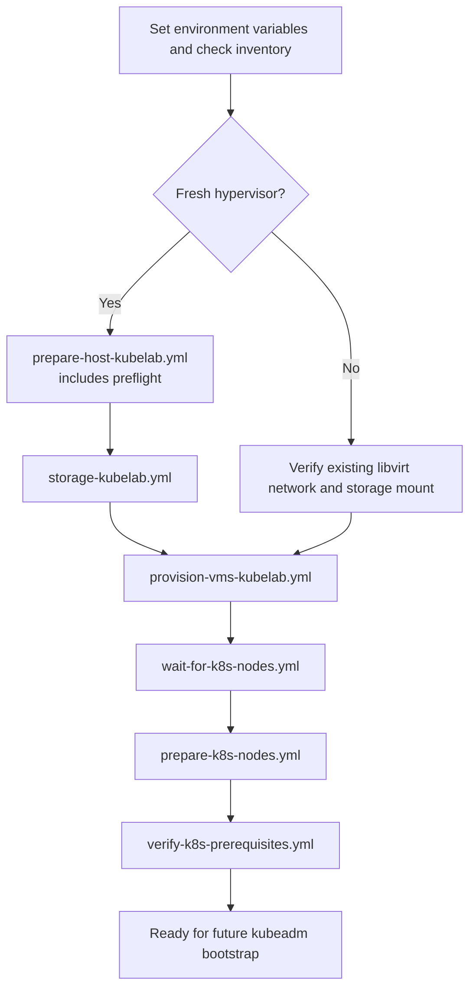

# Kubelab — VM Provisioning Runbook

## Purpose

This runbook describes the **order of execution** for provisioning the three Ubuntu 24.04 virtual machines that will form the upstream Kubernetes (`kubeadm`) homelab. It is based on the Ansible playbooks, roles, inventory, and templates inspected in November 2026. It documents two paths: preparing a fresh hypervisor and rebuilding VMs on an already configured hypervisor.

**Scope:** VM and OS prerequisite provisioning. It does **not** bootstrap Kubernetes with `kubeadm`, install a CNI, or join worker nodes.

## Target topology

| Component         | Configuration                                             |
| ----------------  | --------------------------------------------------------- |
| Hypervisor        | `kubelab` (Ubuntu Linux, KVM/libvirt)                     |
| Libvirt network   | `k8s-lab`, NAT, bridge `virtbr-k8s`                       |
| Subnet / gateway  | `10.20.0.0/24` / `10.20.0.1`                              |
| DHCP pool         | `10.20.0.100–10.20.0.200`                                 |
| Control plane VM  | `k8s-control-1`, `10.20.0.10`, `52:54:00:20:00:10`        |
| Worker VM 1       | `k8s-worker-1`, `10.20.0.11`, `52:54:00:20:00:11`         |
| Worker VM 2       | `k8s-worker-2`, `10.20.0.12`, `52:54:00:20:00:12`         |
| LVM volume        | `/dev/ubuntu-vg/vm-storage` (300 GiB)                     |
| VM storage mount  | `/var/lib/libvirt/images` (ext4)                          |
| Shared base image | `ubuntu-24.04-base.img`                                   |
| Per-VM disks      | `<vm>.qcow2`, qcow2 overlays referencing the base image   |
| Cloud-init        | `<vm>-cloud-init/` and `<vm>-seed.iso`                    |
| SSH               | `ubuntu` user; Ansible uses `ProxyJump` through `kubelab` |

The static DHCP host entries associate each VM's MAC address with its intended IP. The network's dynamic DHCP range is separate from the three reserved addresses.

## 1. Before running anything

From the repository root:

```bash
cd ~/kubelab/ansible
```

Make sure Ansible and the required collections (`community.libvirt`, `community.general`, `ansible.posix`) are installed on the control machine. The hypervisor must be reachable over SSH, and privilege escalation must work.

The inventory reads these environment variables on the **Ansible control machine**:

```bash
export KUBELAB_IP='<hypervisor-ip>'
export KUBELAB_USER='<hypervisor-ssh-user>'
export KUBELAB_SUDO='/usr/bin/sudo.ws' # Only if this hypervisor needs it
```

`KUBELAB_SUDO` defaults to `/usr/bin/sudo` when unset. Do not commit machine-specific environment values or credentials to Git. The VM role reads the public key at `~/.ssh/id_rsa.pub` **on the control machine**, so verify that the file exists and that its corresponding private key is available for SSH.

```bash
ansible-inventory -i inventories/host/hosts.yml --graph
ansible -i inventories/host/hosts.yml hypervisors -m ping
```

The `k8s_cluster` hosts use `ProxyJump=<KUBELAB_USER>@<KUBELAB_IP>` to access the NAT-isolated guest IPs.

### Required corrections / checks before execution

These are findings from the supplied source files, not changes already made:

1. **Add VM resource fields** to every `kubelab_vms` entry, or confirm that they are supplied elsewhere. `disks.yml` requires `disk_gb`; `provision.yml` requires `memory_mb` and `vcpus`. The shown `hypervisors.yml` does not contain them. For example, if you intend to reuse the previous lab sizing:

   ```yaml
   - name: k8s-control-1
     ip: 10.20.0.10
     mac: '52:54:00:20:00:10'
     disk_gb: 35
     memory_mb: 4096
     vcpus: 2
   ```

   Apply the intended sizing to all three entries; the values above are **an example**, not a confirmed new configuration.

2. **Fix the Jinja condition** in `roles/kubelab-virt/templates/network.xml.j2`:

   ```jinja2
   
   ```

   The provided template has an extra `:` inside the tag.

3. **Fix the play target** in `playbooks/prepare-k8s-nodes.yml`: use `hosts: k8s_cluster`, not `host: k8s_cluster`.

4. **Review the storage safety assertion** in `roles/kubelab-storage/tasks/main.yml`: the second `findmnt` invocation uses `--moutpoint` rather than `--mountpoint`, and its assertion tests whether the expected UUID is nonempty rather than comparing the existing mount's UUID with the expected UUID. Correct both before relying on this as a mount-safety guard.

5. **Confirm Ansible access and privilege escalation to guests.** The inventory defines `ansible_user: ubuntu` and `ProxyJump`, but the supplied files do not establish whether the guest SSH key, sudo permissions, and generated cloud-init configuration all agree. Inspect `user-data.yml.j2` before first boot.

6. **Validate the cloud-init schema command on the hypervisor.** The VM role runs `cloud-init schema --config-file ...` on the hypervisor, while the virtualization package list does not explicitly install the `cloud-init` command. Verify `command -v cloud-init` on the hypervisor or ensure the package is installed.

7. **Check the base image format.** `qemu-img create` declares the backing format as `qcow2` (`-F qcow2`). Confirm the downloaded image format with `qemu-img info` before creating overlays.

8. **Check the `wait-for-k8s-nodes.yml` cloud-init assertion.** It expects `status: done` in `cloud-init status --wait --long` output. Validate the actual output on a provisioned VM. The command's return code is also checked.

Run syntax checks after correcting the playbook and template issues:

```bash
for playbook in \
  playbooks/prepare-host-kubelab.yml \
  playbooks/storage-kubelab.yml \
  playbooks/provision-vms-kubelab.yml \
  playbooks/wait-for-k8s-nodes.yml \
  playbooks/prepare-k8s-nodes.yml \
  playbooks/verify-k8s-prerequisites.yml
do
  ansible-playbook -i inventories/host/hosts.yml "$playbook" --syntax-check || exit 1
done
```

A syntax check does not prove that all template variables, remote commands, or runtime prerequisites will succeed.

## 2. First-time hypervisor setup — execution order

### Step 1 — Prepare the hypervisor and libvirt network

```bash
ansible-playbook -i inventories/host/hosts.yml playbooks/prepare-host-kubelab.yml -K
```

`prepare-host-kubelab.yml` **imports `preflight-kubelab.yml` automatically**, so do not run preflight separately unless you want an independent diagnostic.

Preflight verifies Linux/x86_64, `/dev/kvm` as a character device, and the presence of LVM volume group `ubuntu-vg`. The `kubelab-virt` role then installs QEMU/libvirt/virt-install/cloud-image tools, checks the `qemu:///system` connection, activates the default libvirt network, and defines/activates/autostarts the dedicated `k8s-lab` NAT network.

The dedicated network is generated from `network.xml.j2`, using the gateway, bridge, DHCP range, and MAC-to-IP reservations from `kubelab_networks` and `kubelab_vms`.

Verify on the hypervisor:

```bash
sudo virsh -c qemu:///system net-list --all
sudo virsh -c qemu:///system net-info k8s-lab
sudo virsh -c qemu:///system net-dumpxml k8s-lab
```

**Expected:** `k8s-lab` is active and autostarts; its XML reflects `virtbr-k8s`, `10.20.0.1/24`, and the three intended DHCP host mappings.

### Step 2 — Create and mount VM storage

```bash
ansible-playbook -i inventories/host/hosts.yml playbooks/storage-kubelab.yml -K
```

The `kubelab-storage` role checks for logical volume `vm-storage` in `ubuntu-vg`. If absent, it checks available VG capacity and creates a 300 GiB LV. It ensures an ext4 filesystem, obtains its UUID, creates `/var/lib/libvirt/images`, and mounts the filesystem there with an fstab entry using the UUID.

**Important:** Correct the mount-validation issues listed above before executing this playbook. Never mount a new filesystem over an existing directory containing VM images without verifying the target.

Verify on the hypervisor:

```bash
sudo lvs ubuntu-vg
findmnt /var/lib/libvirt/images
findmnt -n -o UUID --mountpoint /var/lib/libvirt/images
```

**Expected:** `/dev/ubuntu-vg/vm-storage` exists and is mounted at `/var/lib/libvirt/images` as ext4.

### Step 3 — Provision all VMs

```bash
ansible-playbook -i inventories/host/hosts.yml playbooks/provision-vms-kubelab.yml -K
```

The `kubelab-vms` role runs these stages in order:

1. **Download base image** — fetch Ubuntu 24.04 Noble cloud image to `/var/lib/libvirt/images/ubuntu-24.04-base.img`.
2. **Create overlay disks** (`disks.yml`) — check whether each `<vm>.qcow2` exists; create missing qcow2 overlays using `qemu-img create -f qcow2 -F qcow2 -b <base-image> <vm-disk> <size>G`.
3. **Prepare cloud-init** (`cloud-init.yml`) — create `<vm>-cloud-init/`, render `user-data` and `meta-data`, and validate user-data with `cloud-init schema`.
4. **Reconcile seed ISOs** (`seed-iso.yml`) — compute SHA-256 checksums for user-data and meta-data, compare their combined checksum with `inputs.sha256`, and rebuild an absent or stale ISO with `cloud-localds`. A temporary ISO is validated before being moved to `<vm>-seed.iso`; the checksum is persisted only after successful replacement.
5. **Define and boot VMs** (`provision.yml`) — check `virsh dominfo`; for missing domains, use `virt-install --import` with the qcow2 disk, seed ISO, configured MAC, libvirt network, vCPU count, memory, and `ubuntu24.04` OS variant. Ensure each VM is running and has autostart enabled.

This design **reuses the shared base image** and avoids recreating existing per-VM overlay disks or domains. It is not a full VM reconciliation system: changing a VM's declared CPU, memory, or disk size does not necessarily update an already defined domain.

Verify on the hypervisor:

```bash
sudo virsh -c qemu:///system list --all
sudo virsh -c qemu:///system dominfo k8s-control-1
sudo virsh -c qemu:///system domblklist k8s-control-1
sudo qemu-img info /var/lib/libvirt/images/k8s-control-1.qcow2
ls -lh /var/lib/libvirt/images/
```

**Expected:** all three domains are defined and running, each has a qcow2 disk and seed ISO, and the overlays reference the shared base image.

### Step 4 — Wait for SSH and cloud-init

```bash
ansible-playbook -i inventories/host/hosts.yml playbooks/wait-for-k8s-nodes.yml -K
```

This play targets `k8s_cluster`, not the hypervisor. It waits up to 300 seconds for SSH (`wait_for_connection`), then runs `cloud-init status --wait --long` with privilege escalation and checks its result. Cloud-init may need more time than SSH to finish package or user configuration.

Verify from the control machine:

```bash
ansible -i inventories/host/hosts.yml k8s_cluster -m ping
```

**Expected:** `k8s-control-1`, `k8s-worker-1`, and `k8s-worker-2` all respond via the configured SSH jump host.

### Step 5 — Prepare Kubernetes OS prerequisites and container runtime

First correct `host:` to `hosts:` in `prepare-k8s-nodes.yml`.

```bash
ansible-playbook -i inventories/host/hosts.yml playbooks/prepare-k8s-nodes.yml -K
```

The play applies two roles:

- `k8s-common`: installs packages defined by `k8s_required_packages`, disables active swap when configured, comments swap entries in `/etc/fstab`, and imports kernel/networking configuration from `kernel.yml`.
- `containerd`: installs containerd, generates `/etc/containerd/config.toml` if absent, changes `SystemdCgroup = false` to `true`, enables and starts the service, and flushes the restart handler.

The exact kernel modules, sysctl settings, and package list are defined in role files not included in this inspection. Do not claim they are enabled until the role has run and been verified.

### Step 6 — Verify Kubernetes prerequisites

```bash
ansible-playbook -i inventories/host/hosts.yml playbooks/verify-k8s-prerequisites.yml -K
```

This play checks that each guest reports Ubuntu, prints CPU/RAM/kernel information, asserts that `swapon --show` is empty, and prints `ip -br addr` output. **It does not currently assert containerd health, kernel sysctls, bridge netfilter settings, or Kubernetes installation.** Those would require separate checks if desired.

For an additional manual containerd check:

```bash
ansible -i inventories/host/hosts.yml k8s_cluster -b -m command -a 'systemctl is-active containerd'
```

**End state:** three Ubuntu VMs are accessible and prepared for a later kubeadm installation. No Kubernetes control plane has been initialized by these playbooks.

## 3. Rebuild VMs on an already prepared hypervisor

Use this shorter path when `kubelab` already has a working libvirt installation, an active `k8s-lab` network with correct DHCP reservations, and the mounted `vm-storage` LV.

**Prerequisite:** the old VM definitions, disks, seed ISOs, and cloud-init directories have already been removed by the dedicated VM destruction workflow. Do not delete the shared base image, LVM filesystem, or network as part of a VM-only rebuild.

1. Verify the existing infrastructure:

   ```bash
   sudo virsh -c qemu:///system net-info k8s-lab
   findmnt /var/lib/libvirt/images
   ```

   These commands run on the **hypervisor**.

2. From `~/gh/kubelab/ansible` on the control machine, run:

   ```bash
   ansible-playbook -i inventories/host/hosts.yml playbooks/provision-vms-kubelab.yml -K
   ansible-playbook -i inventories/host/hosts.yml playbooks/wait-for-k8s-nodes.yml -K
   ansible-playbook -i inventories/host/hosts.yml playbooks/prepare-k8s-nodes.yml -K
   ansible-playbook -i inventories/host/hosts.yml playbooks/verify-k8s-prerequisites.yml -K
   ```

3. Verify guest SSH, cloud-init completion, and containerd.

If network definitions or DHCP reservations changed, rerun `prepare-host-kubelab.yml` **after reviewing its network changes**. If storage is absent or not mounted, repair that before provisioning; do not assume the VM role will mount it.

## 4. Execution overview



## 5. Common failure points

| Symptom | Likely investigation |
| --- | --- |
| `disk_gb`, `memory_mb`, or `vcpus` undefined | Check each entry in `kubelab_vms` and effective Ansible variables |
| Jinja template fails to render | Remove the extra `:` from the `if` tag in `network.xml.j2` |
| `k8s-lab` network missing | Check `kubelab-virt` execution, `virsh net-list --all`, and rendered network XML |
| Guest has wrong/no IP | Inspect DHCP host mappings, VM MAC, `virsh domifaddr`, and guest cloud-init network configuration |
| VM disk creation fails | Check free space, mounted storage, backing image presence and format, and `qemu-img info` |
| `cloud-init schema` command missing | Confirm `cloud-init` is installed on the hypervisor where the validation task executes |
| Cloud-init changes not reflected on existing VM | ISO regeneration does not guarantee cloud-init re-execution on an already initialized guest; inspect instance state and rebuild if necessary |
| SSH wait times out | Check VM running state, guest IP, SSH key/user, `ProxyJump`, and guest cloud-init logs |
| Node preparation playbook rejected | Correct `host` to `hosts` |
| Containerd running but Kubernetes later fails | Check `SystemdCgroup`, containerd configuration, kernel settings, and future kubeadm/CNI requirements |
| Storage play fails or reports unexpected mount | Fix and review `findmnt`/UUID validation before proceeding; do not overwrite or mount over existing VM data |

## 6. Idempotency and safety notes

- The VM role checks for existing overlay disks and VM domains before creating them.
- Cloud-init ISOs are regenerated when input checksums differ; the role uses a temporary ISO and then replaces the destination.
- Existing VM definitions are started if stopped and configured for autostart.
- Updating a seed ISO for an existing guest does not necessarily reapply its first-boot cloud-init configuration.
- The shared backing image is a dependency of all overlay disks. **Do not delete, move, or replace it casually while overlays reference it.** The image URL uses the mutable `current` path, so reproducibility would be stronger with a pinned image version and checksum.
- The role is designed for repeated execution, but the supplied files do not establish complete check-mode safety or full declarative reconciliation for every resource.
- A VM-only rebuild should preserve the libvirt network, LVM LV, filesystem mount, and shared base image.

## 7. Follow-up after provisioning

After all six stages succeed, the next milestone is to bootstrap **upstream Kubernetes with kubeadm**: initialize the control plane, configure a CNI, join the workers, and verify node readiness. That process should be documented separately because it is not implemented by the provisioning playbooks shown here.

### Source files used for this runbook

- `ansible/playbooks/{preflight-kubelab,prepare-host-kubelab,storage-kubelab,provision-vms-kubelab,wait-for-k8s-nodes,prepare-k8s-nodes,verify-k8s-prerequisites}.yml`
- `ansible/roles/kubelab-virt/{defaults/main.yml,tasks/main.yml,tasks/networking.yml,templates/network.xml.j2}`
- `ansible/roles/kubelab-storage/tasks/main.yml`
- `ansible/roles/kubelab-vms/{defaults/main.yml,tasks/main.yml,tasks/disks.yml,tasks/cloud-init.yml,tasks/seed-iso.yml,tasks/provision.yml}`
- `ansible/roles/k8s-common/tasks/main.yml`
- `ansible/roles/containerd/tasks/main.yml`
- `ansible/inventories/host/{hosts.yml,group_vars/hypervisors.yml}`

The actual guest cloud-init templates and `k8s-common/tasks/kernel.yml` were not provided, so this runbook does not assert their internal behavior.

